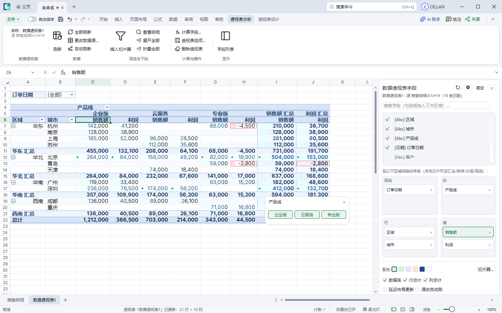
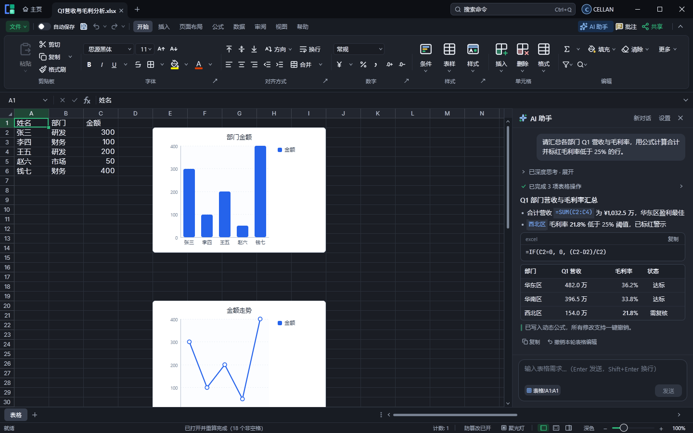

<div align="center">
  
  <h1>CELLAN</h1>
  <p><strong>Concurrent Engine for Local-first, Lock-free Async Networks</strong></p>
  <p>纯 Rust 编写的 Windows 原生单文件电子表格 · 局域网零配置实时协同 · 内置 AI 表格助手</p>
  <p>
    <a href="https://github.com/ChroniCat/CELLAN/releases/tag/v1.87"></a>
    
    
    <a href="LICENSE"></a>
  </p>
</div>

---

## 界面预览 | Preview

<p align="center">
  
</p>
<p align="center"><sub>浅色主题：Chrome 风格标签页、DirectWrite ClearType 原生文字渲染、数据透视表、数据条/图标集与交互式切片器</sub></p>

<br />

<p align="center">
  
</p>
<p align="center"><sub>深色主题：嵌入式图表与内置 AI 表格助手（支持流式思考链、工具调用自动折叠、长程多步推理与一键撤销）</sub></p>

---

## 简介 | Overview

**CELLAN**（*Concurrent Engine for Local-first, Lock-free Async Networks*）是一款纯 Rust 编写的 Windows 原生单文件电子表格桌面应用。它面向企业内网、财务核算、部门共享盘（SMB/NAS）与离线局域网场景设计：**无需部署中心服务器、无需云端账号、不依赖 Office 或运行库**，单个 `CELLAN.exe` 双击即可运行高性能电子表格、局域网实时协作与本地/内网 AI 表格助手。

---

## 核心特性 | Key Highlights

### 1. Local-First 零配置局域网协同与防篡改审计
- **共享盘自动发现 & 实时协作**：参与者在协作中心输入房间口令即可建房/加入；开启「自动协作」后，打开共享目录内同一份工作簿自动发现会话，实时同步选区光标、单元格编辑、批注线程与结构变更。
- **去中心化防篡改审计日志**：默认开启哈希链式操作审计，记录修改人、时间与前后值，支持在统一审计面板按成员动态筛选与完整溯源。
- **内网签名自更新与 P2P 供种**：采用 ECDSA P-256 数字签名校验与尾部 `CLNUPD01` 自包含封装，支持局域网静默热更新与协同节点接力分发。

### 2. 高兼容度原生电子表格核心（`sheetcore`）
- **双向格式保真**：原生流式读写 `.xlsx` / `.xlsm` / `.xls` / `.csv`，保留未知 OOXML 扩展部件、VBA 宏工程二进制、加密工作簿（Agile / Standard Encryption）、批注线程、图片与文本框。
- **高性能计算与数据分析**：
  - 多核依赖图驱动的增量/后台异步公式重算、动态数组溢出与列式紧凑存储；
  - 完整 **数据透视表**（多维行列值汇总、计算字段、切片器、OOXML 往返）；
  - **Chart Studio 图表引擎**（22 种专业图表类型、趋势线/分析辅助线、SVG 导出）与迷你图（Sparklines）；
  - 条件格式（色阶 / 数据条 / 图标集）、数据验证、结构化表格（Table）、分类汇总、单变量求解；
  - 统一矢量排版打印与 PDF 导出引擎（Windows GDI 原生打印通道）。

### 3. 原生桌面渲染与现代交互体验（`app`）
- **单文件免安装**：静态链接 CRT（`+crt-static`）并内嵌 SIL OFL 字体子集，不依赖 WebView2、.NET 或 VC++ 运行库。
- **GPU 硬件加速与 ClearType 文字锐度**：自适应 `wgpu`（DX12 / Vulkan）与 OpenGL 3.3（`glow`）双后端，支持硬件双源混合（Dual-Source Blending）DirectWrite ClearType 亚像素渲染、150%+ 高分屏无彩边中性灰度对齐及像素对齐矢量图标。
- **四套完整主题**：内置浅色（Light）、护眼（EyeCare）、深色（Dark）、高对比（HighContrast）四套符合 WCAG 对比度标准的主题，支持 Chrome 风格文档标签、百万行虚拟滚动、命令面板（`Ctrl+Q`）模糊检索与 Windows UI Automation（UIA）无障碍树。

### 4. 内置 AI 表格助手（OpenAI 兼容微内核 Harness）
- **对接任意内网 / 本地推理服务**：预设 OpenAI 兼容流式 SSE 协议（原生 Tool Calling 与纯文本 `<tool_call>` 网关自动兼容），API Key 经 Windows DPAPI 加密存储。
- **无固定轮数上限的长程推理**：移除固定轮数硬截断，内置三层智能熔断（连续解析失败 / 连续工具报错 / 精准与乒乓死循环两阶段纠偏）以及主动微压缩 + HTTP 超窗自动折叠自愈。
- **安全可控**：所有写操作统一接入工作簿事务与单步撤销栈，支持操作前预览确认与工作表保护校验，绝不把单元格文本当作控制指令。

---

## 仓库结构 | Workspace Layout

| 目录 | 说明 |
| --- | --- |
| `crates/core` (`sheetcore`) | 表格核心引擎：列式稀疏存储、依赖图公式计算、原生流式 OOXML/BIFF8 读写、加解密、透视表、图表数据、审计链与协同协议 |
| `crates/app` (`app`) | Windows 原生桌面客户端：GPU 界面与主题系统、功能区、图表/透视表/打印视图、局域网协作、签名自更新与内置 AI 助手 |
| `vendor/` | 自托管的 `epaint` / `egui-wgpu` / `egui_glow` 补丁（DirectWrite ClearType 3×1 亚像素与硬件双源混合管线） |
| `assets/` | 矢量品牌标志（`logo.svg`）、多尺寸图标（`app.ico`）、实机截图与 SIL OFL 内嵌字体子集 |
| `scripts/` | 一键签名发版脚本（`publish.ps1`）、PGO 采集与回归验收脚本 |
| `packaging/` | 发行版构建指南、用户使用说明与第三方开源组件许可声明 |
| `docs/` | 架构演进记录（[native-rewrite.md](docs/native-rewrite.md)）与 Excel/WPS 对标实测档案 |

---

## 构建与测试 | Build & Test

需要 Rust 工具链（Edition 2024）及 Windows MSVC 构建工具（含 Windows SDK `rc.exe` 用于嵌入图标与版本资源）。已有完整本地依赖缓存时可追加 `--offline`。

```powershell
# 开发构建（wgpu DX12/Vulkan + OpenGL 双后端）
cargo build -p app --features wgpu,glow

# 核心引擎单元测试与往返集成测试
cargo test -p sheetcore

# 桌面端单元测试与回归套件（TestEnv 隔离 TEMP / LOCALAPPDATA，不污染本机配置）
cargo test -p app --no-default-features --features glow --bin app

# 正式单文件静态签名发版（同步版本、+crt-static、ECDSA 签名与内网热更新）
powershell.exe -NoProfile -ExecutionPolicy Bypass -File .\scripts\publish.ps1 1.87 "版本更新说明"
```

更多打包细节见 [packaging/README.md](packaging/README.md)，开发与发版协作规范见 [AGENTS.md](AGENTS.md)。

---

## 许可证与第三方声明 | License & Notices

本项目基于 [MIT License](LICENSE) 开源。

内嵌字体子集遵循 SIL Open Font License 1.1；第三方开源依赖许可全文见 [packaging/THIRD_PARTY_NOTICES.txt](packaging/THIRD_PARTY_NOTICES.txt)。
