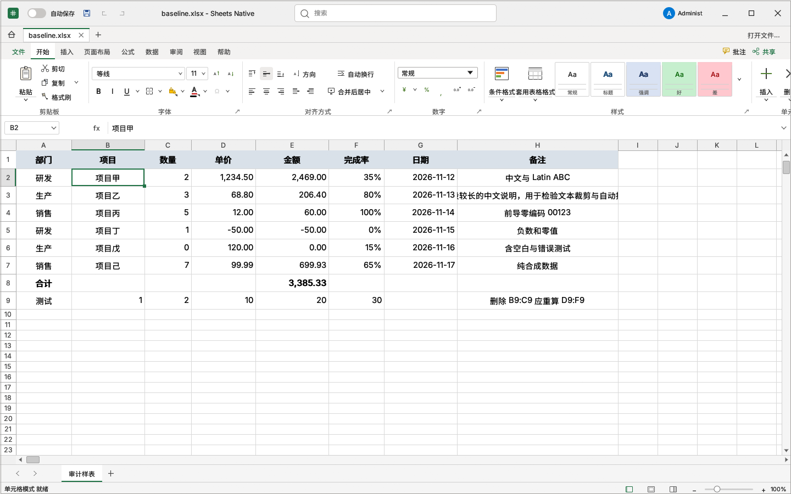
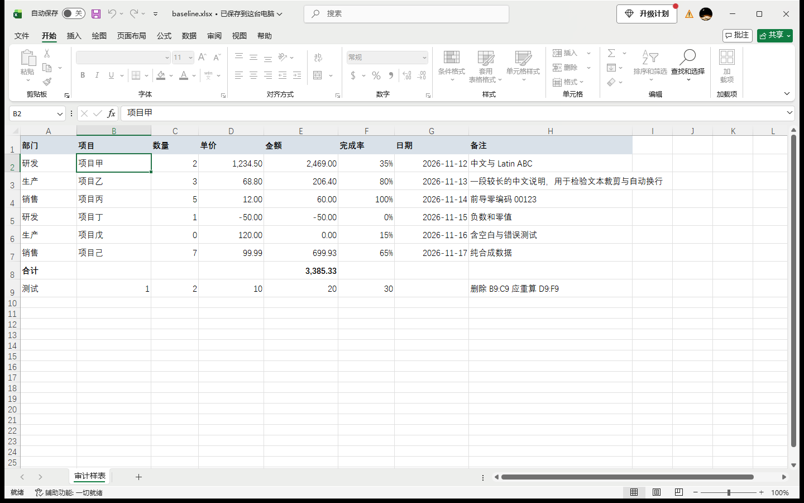
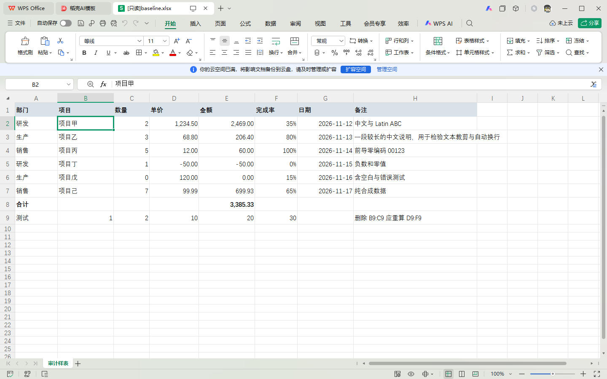
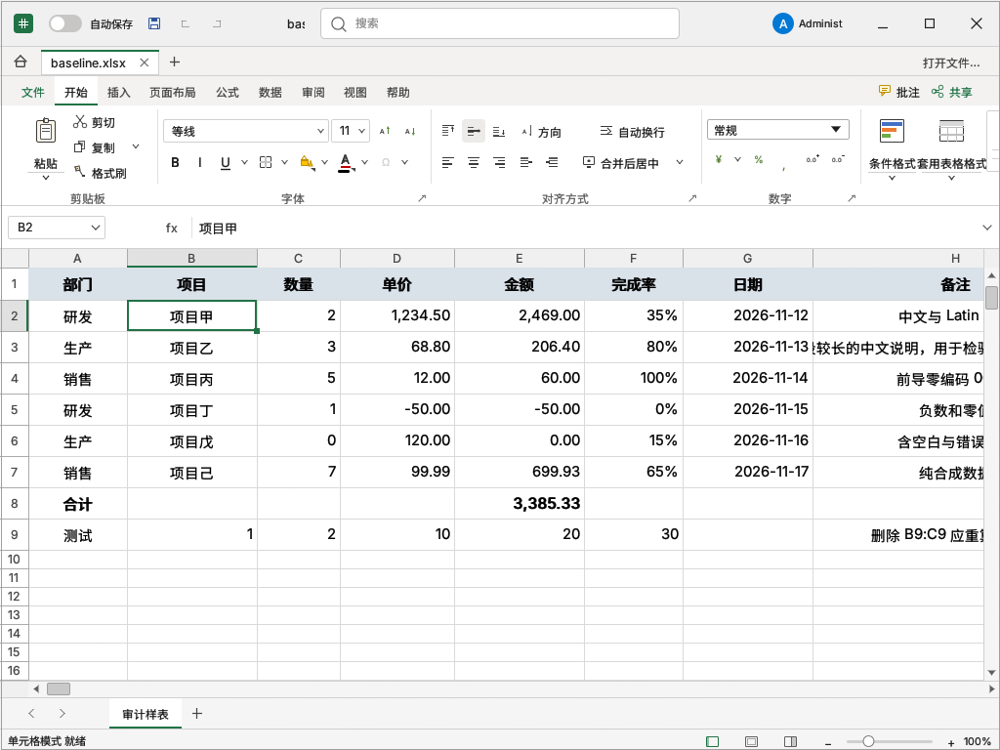
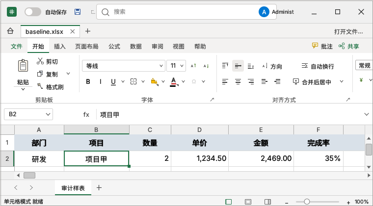
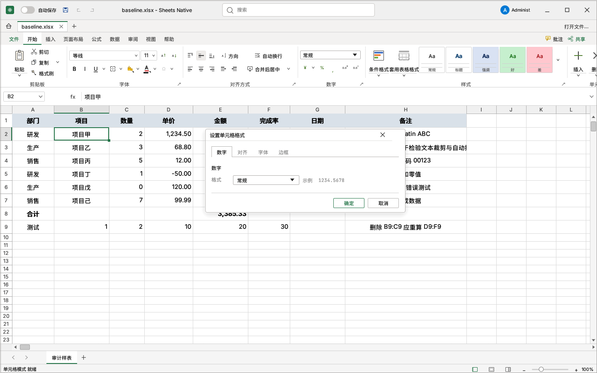
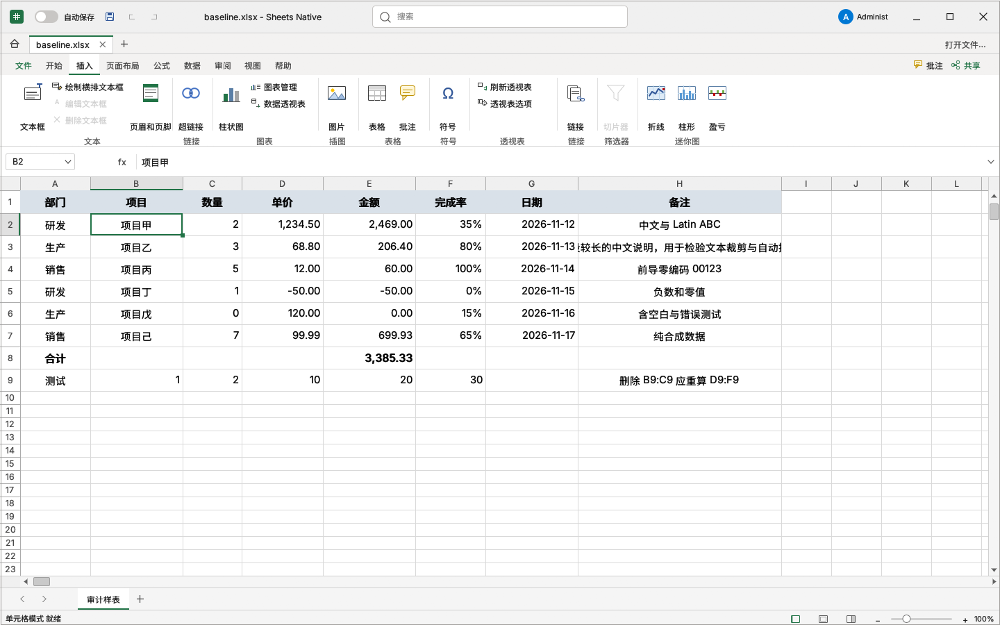
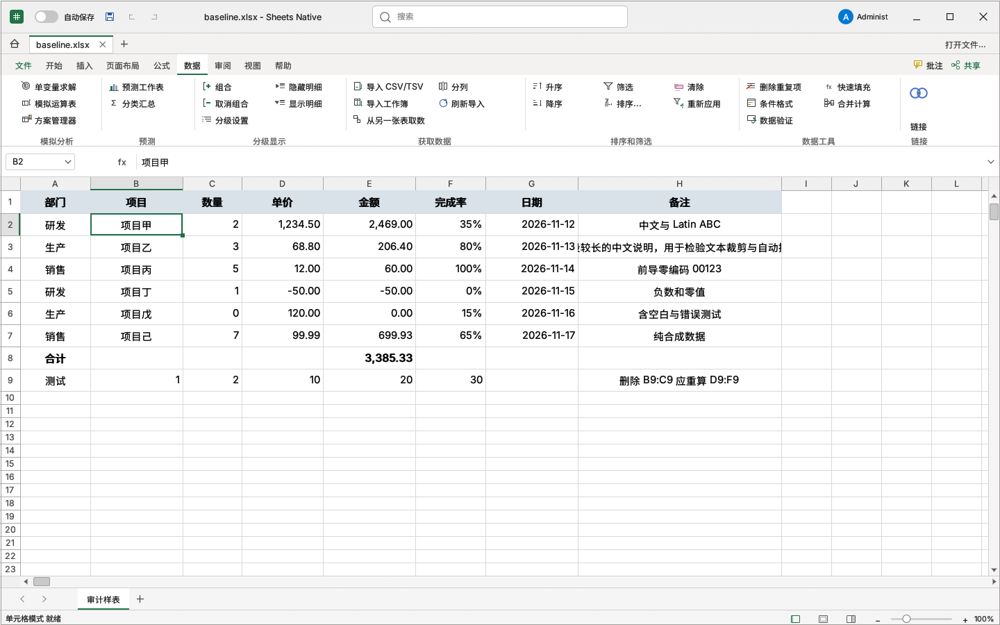
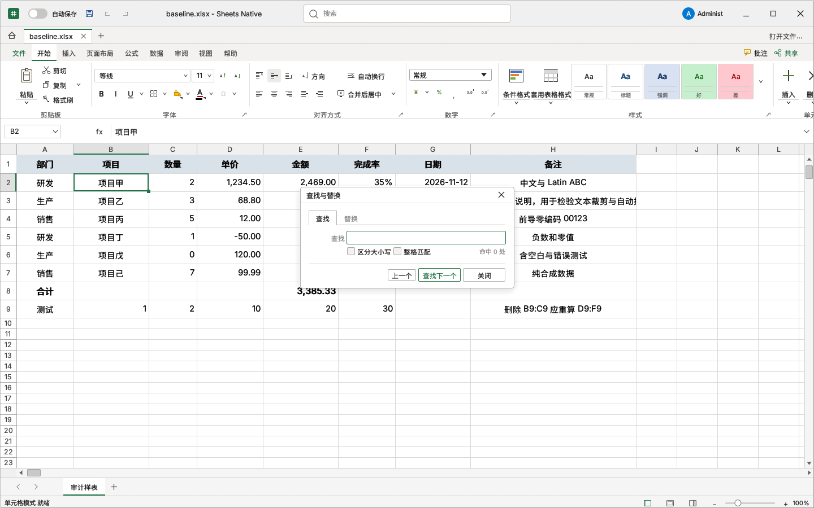

# 三方界面对照与设计验收

下列截图来自本机实际程序，不是设计稿。使用同一份合成工作簿、相同1440×900窗口、100%工作表缩放；后续实现应重新生成截图。三款并非同一布局体系，不能用全图像素相似度评价完成度。

## 1 同表主界面

### 本项目

### Excel

### WPS

Excel截图含未激活窗口导致的灰显控件；WPS为只读副本并显示当前账号的云空间提示条。两者用于布局和单元格显示比较，不能根据灰显/只读状态推断正常编辑时的能力。WPS提示条不属于本项目需复制的元素。

## 2 可见问题与修改合同

| 区域 | 严格观察 | 修改要求 | 验收 |
|---|---|---|---|
| 单元格文字 | App的“研发/项目甲/备注”居中；Excel/WPS左对齐。长H3只见中段 | 修复General类型对齐，单独处理文本/数字/布尔/错误 | C22；同表各类型与基准相符，长文本开头不能凭空消失 |
| 字体 | 文件字体名是等线，App字形/字重观感明显不同。A2的bold解析为false | 真实字体加载、缺字回退、真实字重；不可只统一缩字号 | UI-14、C18；字形与测量联动，保存保留原名 |
| 开始Ribbon | App1440宽右端“单元格/编辑”组被裁，Excel/WPS同宽组织更紧凑 | 收缩图标/标签/分组，提供可见溢出；不能依赖隐藏横向滚动手势 | UI-13；保存、筛选、排序、查找均可发现 |
| 样式库 | App五张较宽样式卡消耗明显横向空间 | 宽度紧张先降级为紧凑图库/下拉，不挤掉高频编辑 | 1440与1024宽都可达全部命令，不需要猜测能横滑 |
| 顶部占用 | App额外文档标签行，公式栏较高；网格数据首行约y274，Excel/WPS约y244 | 保留标签功能，压缩重复间距；尺寸采用逻辑像素 | 在1440×900/100%建议首数据行顶部≤260；若有状态条需单列解释 |
| 标题搜索 | 固定宽搜索框、小窗口抢占文件名；语义却是单元格查找 | 标题按优先级收缩；UI-22提供命令搜索或准确命名 | 760宽窗口按钮/保存仍完整，完整文件名可tooltip查看 |
| 编辑栏 | ×/✓仅编辑态显示；固定高度占用，扩展逻辑需真实焦点验证 | 名称框、编辑状态、公式栏展开收起统一；内容可长公式编辑 | 输入焦点不互抢，取消/确认一次生效，Alt+Enter按光标插入 |
| 工作表/状态栏 | 已有标签、加号、视图与zoom，不能重写成静态摆设 | 每表视图状态和统计完善；状态反映真实dirty/计算/保存 | UI-16/25；切表恢复位置，保存失败不显示已保存 |
| 图标与文字 | 图标来源和自绘风格混用；部分状态难以区分 | 统一视觉尺寸、笔重、选中/悬停/焦点/禁用态和tooltip | UI-29；小尺寸清晰，键盘焦点可见，禁用有解释 |

以上像素位置为截图人工读数，约±3px，仅用于比较这组条件；不能当成所有DPI、所有Office布局版本的固定值。建议目标是本项目的设计合同，不是声称Excel强制要求某个像素数。

## 3 小窗口

最小窗能显示的正文行很少，功能区右侧大量命令不可见。不能把“窗口能缩小且没有崩溃”当成适配完成。设计按四档宽度处理：≥1440完整组、1024–1439紧凑组、760–1023分组菜单、<760维持产品最小窗口限制。垂直空间不足时允许折叠Ribbon并提供明确恢复入口。最小窗仍须能完成输入、保存、取消、查找和修改格式。

## 4 格式与功能区

窗口只有数字、对齐、字体、边框四页，数字页显示固定1234.5678示例，与当前B2文本无关。没有必要复制Office每个低频选项，但已有选项应名实相符、取消无副作用、混合选区只改指定属性；填充、保护、自定义数字格式属于优先补齐项。

数据页已经有导入CSV/TSV、刷新、排序、去重、验证、分类汇总等。截图直接否定旧文档“这些入口均缺失”的说法。当前需求应审查范围、预览、撤销、错误处理和保存，不应再造一套重复按钮。

## 5 统一视觉验收规范

1. **比较条件：** 同一合成文件、同一选区/滚动位置、同一系统DPI/工作表zoom/字体、相同窗口尺寸；窗口尺寸与客户区尺寸分别记录。图片、字体渲染后端差异须记在manifest。
2. **布局：** 任意已支持尺寸没有文字或按钮相互覆盖、关键按钮在可视区外、不可发现的水平溢出。对话框最多占工作区90%，长列表滚动，底部确定/取消保持可达。
3. **尺寸建议：** 控件常规点击高度24–28逻辑px，小图标16–20、大图标28–32；相邻同类控件中心/文字基线误差≤1逻辑px。属于本项目设计目标，允许通过明确设计修订调整。
4. **文本：** 不截中文半字；名称/标签溢出时省略+完整tooltip；单元格裁剪遵循数据类型、相邻格占用、对齐/换行规则，不能套用通用UI省略号。
5. **状态：** normal、hover、pressed、selected、disabled、keyboard-focus分别截图；不要只改变颜色造成低对比。错误反馈包含原因、受影响范围、下一步，避免仅在状态栏闪一下。
6. **缩放：** 工作表50/100/200%不改变标题、Ribbon和对话框尺寸；系统100/125/150/200%DPI负责整个UI比例；两种缩放分开测试。
7. **画面容差：** 数值/文字/对象数量/行列归属必须精确；同字体文字框宽高建议误差≤2逻辑px或2%取较大值；渲染抗锯齿允许像素级差异。任何裁掉金额末位、日期变值或对象漏画均不受容差豁免。
8. **交付证据：** 每类组件至少一张修改前/后图、目标尺寸、已验证DPI、真实操作结果。几何dump可补充，但不能代替截图和操作验收。

125%–200%DPI和各种交互状态尚未在本轮穷尽；由QA-05/UI-29建立后续基线。不要把本页建议尺寸直接散落为更多魔法数字，应集中在设计常量与布局模型中。
